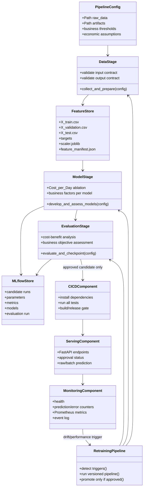

# BPMN and UML architecture diagrams

These diagrams are Mermaid source and render in GitHub, supported VS Code
previews, and Mermaid Live. They describe the complete executable lifecycle.

## BPMN-aligned integrated process

```mermaid
flowchart LR
  subgraph DM[Data Management & Analysis]
    A((Business understanding complete)) --> B[Identify data source and requirements]
    B --> C[Acquire raw CSV]
    C --> D[Describe data]
    D --> E[Explore and assess quality]
    E --> F{Data sufficient and contract valid?}
    F -- No --> B
    F -- Yes --> G[Prepare and engineer features]
    G --> H[Develop and validate data pipeline]
    H --> FS[(Feature store)]
  end

  subgraph AM[Analytical Modeling]
    FS --> I{Hypothesis needed?}
    I -- Yes --> J[Define and record hypotheses]
    I -- No --> K[Select candidate algorithms]
    J --> K
    K --> L[Define model test design]
    L --> M[Develop candidate models]
    M --> MS[(MLflow metadata store)]
    M --> MR[(Candidate model registry)]
    M --> N[Assess validation performance and business factors]
    N --> O{Performance sufficient?}
    O -- No --> P[Further experiments or data modification]
    P --> K
    O -- Yes --> Q[Integrated analytical pipeline]
  end

  subgraph EV[Domain Expertise / Strategy & Project Management]
    Q --> R[Assess analytical results]
    R --> S[Cost-benefit and business-objective assessment]
    S --> T{Business goals satisfied?}
    T -- No --> U((Return to business understanding))
    T -- Yes --> V[Process evaluation and checkpoint]
    V --> W{Proceed to deployment?}
    W -- No --> U
    W -- Yes --> X[Impact assessment]
  end

  subgraph DP[Data Infrastructure & Operations - Deployment]
    X --> Y[Plan deployment, monitoring and maintenance]
    Y --> Z[Deployment tests]
    Z --> AA{Tests successful?}
    AA -- No --> Y
    AA -- Yes --> AB[Business integration]
    AB --> AC((Technical system available))
  end

  subgraph UT[Utilization and Continuous Training]
    AC --> AD[Domain-user utilization]
    AD --> AE[Monitoring and support]
    AE --> AF{Maintenance or retraining needed?}
    AF -- Yes --> AG[Versioned guarded retraining]
    AG --> AE
    AF -- No --> AH{Continue system?}
    AH -- Yes --> AD
    AH -- No --> AI((System discontinuation))
  end
```



## UML component diagram



## UML retraining sequence

```mermaid
sequenceDiagram
  actor Scheduler as Scheduler/Operator
  participant RT as Retraining controller
  participant DS as Data stage
  participant MS as Model stage
  participant MF as MLflow
  participant EV as Evaluation gate
  participant REG as Model registry

  Scheduler->>RT: schedule, new-data, performance, or --force trigger
  RT->>RT: compare source hash, age, observed metric
  alt trigger exists
    RT->>DS: validate contracts and rebuild versioned feature store
    DS-->>RT: quality-approved features
    RT->>MS: train, compare, ablate Cost_per_Day
    MS->>MF: log candidate runs, models, metrics
    MS-->>EV: frozen candidate and threshold
    EV->>EV: untouched-test and business-cost assessment
    EV->>MF: log evaluation and reports
    alt every business gate passes
      EV->>REG: promote candidate to champion
    else any gate fails
      EV-->>RT: reject; preserve existing champion
    end
  else no trigger
    RT-->>Scheduler: skip and report reason
  end
```
