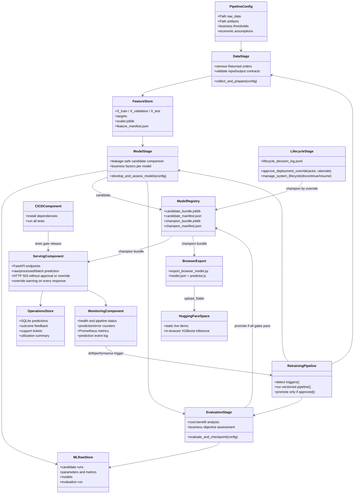
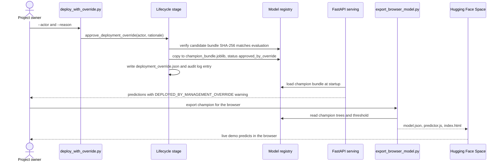
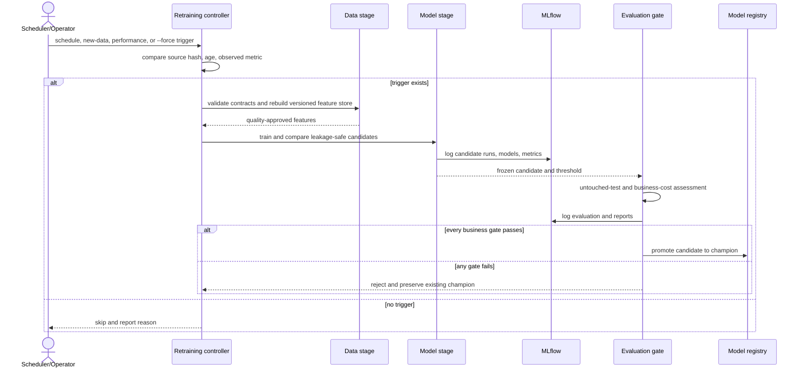

# BPMN and UML architecture diagrams

These diagrams are Mermaid source and render in GitHub, supported VS Code
previews, and Mermaid Live. They describe the complete executable lifecycle,
including the audited management override that deploys the XGBoost prototype
although its evaluation gates failed, and the Hugging Face live demo.

## BPMN-aligned integrated process

```mermaid
flowchart LR
  subgraph DM[Data Management & Analysis]
    A((Business understanding complete)) --> B[Identify data source and requirements]
    B --> C[Acquire raw CSV]
    C --> C2[Remove Returned orders: keep Delivered and Delayed]
    C2 --> D[Describe data]
    D --> E[Explore and assess quality]
    E --> F{Data sufficient and contract valid?}
    F -- No --> B
    F -- Yes --> G[Prepare and engineer order-time features]
    G --> H[Develop and validate data pipeline]
    H --> FS[(Feature store)]
  end

  subgraph AM[Analytical Modeling]
    FS --> I{Hypothesis needed?}
    I -- Yes --> J[Define and record hypotheses]
    I -- No --> K[Select candidate algorithms]
    J --> K
    K --> L[Define model test design]
    L --> M[Develop candidate models]
    M --> MS[(MLflow metadata store)]
    M --> MR[(Candidate model registry)]
    M --> N[Assess validation performance and business factors]
    N --> O{Performance sufficient?}
    O -- No --> P[Further experiments or data modification]
    P --> K
    O -- Yes --> Q[Integrated analytical pipeline: XGBoost selected]
  end

  subgraph EV[Domain Expertise / Strategy & Project Management]
    Q --> R[Assess untouched-test results]
    R --> S[Cost-benefit and business-objective assessment]
    S --> T{Business goals satisfied?}
    T -- Yes --> V[Process evaluation and checkpoint]
    T -- No --> OV{Management override recorded?}
    OV -- No --> U((Return to business understanding))
    OV -- Yes --> OVR[Record actor, rationale, failed gates in audit log]
    V --> W{Proceed to deployment?}
    W -- No --> U
    W -- Yes --> X[Impact assessment]
    OVR --> X
  end

  subgraph DP[Data Infrastructure & Operations - Deployment]
    X --> Y[Plan deployment, monitoring and maintenance]
    Y --> Z[Deployment tests and smoke test]
    Z --> AA{Tests successful?}
    AA -- No --> Y
    AA -- Yes --> AB[Business integration: FastAPI service and Hugging Face Space]
    AB --> AC((Technical system available))
  end

  subgraph UT[Utilization and Continuous Training]
    AC --> AD[Domain-user utilization]
    AD --> AE[Monitoring, outcome feedback and support tickets]
    AE --> AF{Maintenance or retraining needed?}
    AF -- Yes --> AG[Versioned guarded retraining]
    AG --> AE
    AF -- No --> AH{Continue system?}
    AH -- Yes --> AD
    AH -- No --> AI((System discontinuation))
  end
```

## UML component diagram

## UML deployment-by-override sequence

## UML retraining sequence

