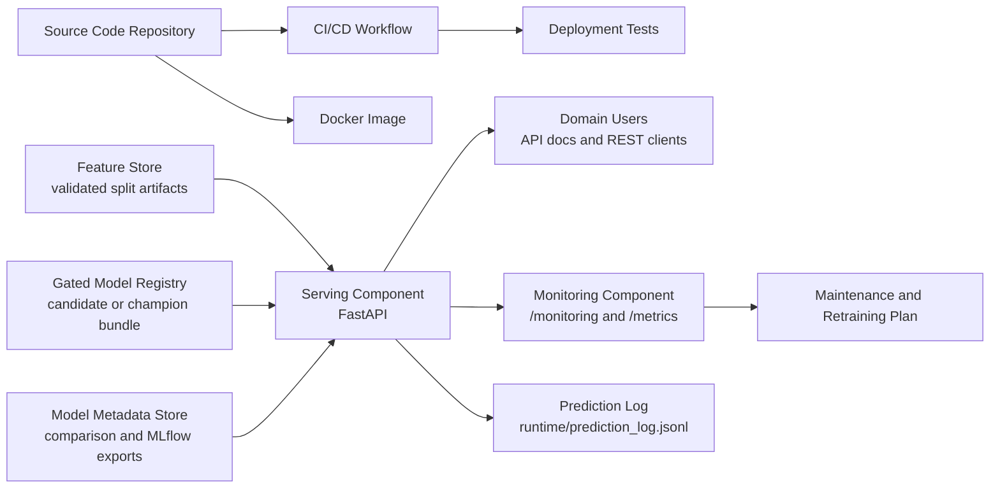

# Deployment Documentation

> Current status: **deployed by management override.** The evaluation decision is
> still `RETURN_TO_BUSINESS_UNDERSTANDING` (the model failed its business gates).
> The project owner recorded an audited override so the prototype can be
> demonstrated; every prediction response states this and carries a warning.

## Deployment by management override

The evaluation result is unchanged: the model **failed** its business gates
(`RETURN_TO_BUSINESS_UNDERSTANDING`). Because the course requires a deployed,
demonstrable prototype, the project owner recorded an explicit, audited
deployment override:

```powershell
python scripts/deploy_with_override.py --actor "Vivek Kumar Singh (project owner)" `
  --reason "Course requirement: the prototype must be deployed and demonstrated end to end even though the evaluation gates failed."
```

The override:

- copies the exact evaluated candidate bundle (SHA-256 checked) to `champion_bundle.joblib`;
- writes `champion_manifest.json` with `promotion_status = approved_by_override`, the actor, rationale, failed gates, and test metrics;
- writes `artifacts/reports/deployment_override.json` and appends to `artifacts/lifecycle_decision_log.jsonl`;
- sets the lifecycle status to `DEPLOYED_BY_OVERRIDE_EVALUATION_GATES_FAILED`.

The API then serves predictions, and every response contains
`"deployment_basis": "DEPLOYED_BY_MANAGEMENT_OVERRIDE"` plus a warning that
the model failed evaluation. Without an override, prediction endpoints return
HTTP 503. To withdraw the deployment:

```powershell
python scripts/manage_lifecycle.py discontinue --actor "<name>" --reason "<why>"
```


## Source Requirements

The deployment work follows the two assignment documents:

- `STP_ecommerce.pdf`: requires preparing and executing deployment of the ML-powered system, including testing, and demonstrating use, monitoring, and maintenance for the prototype.
- `DSPM_material_STP.pdf`: defines deployment as impact assessment, deployment plan, deployment test, monitoring and maintenance planning, and business integration through a serving component. It also states that the deployed solution should be treated as an ML production pipeline, not only a standalone model.

## Previous Deployment Audit

The previous deployment version contained:

- FastAPI serving component in `deployment/app.py`
- Dockerfile for container execution
- README commands for local execution and Docker
- Prediction endpoints for raw and already processed inputs

The previous version did not yet cover all deployment-stage expectations:

- no formal impact assessment
- no deployment test suite
- no CI/CD workflow
- no monitoring component
- no utilization demonstration
- no maintenance or retraining plan
- no architecture/process documentation
- no explicit mapping to feature store, model registry, model metadata store, serving component, and monitoring component

The implementation now adds those missing artifacts.

## Model and Approval Status

The earlier notebook called `XGBoost binary` the deployment model. That result
is now treated as historical because the notebook reused test data during
threshold selection and the model did not demonstrate useful discrimination.
The corrected pipeline selects a candidate on validation data and then applies
an independent test/business checkpoint. The current candidate is rejected.
XGBoost is the final selected algorithm for the academic prototype.
It did not pass evaluation and is served only under the recorded override.

The gated service is designed to predict:

- `1`: Delivered
- `0`: Delayed

`Returned` orders are out of scope and are removed from the data before
training, so the service never predicts or reports them.

Current artifacts:

- Authoritative feature store: `artifacts/feature_store/`
- Candidate registry and approval manifest: `artifacts/model_registry/`
- Model metadata store: `artifacts/model_metadata_store/`
- MLflow SQLite backend and artifact store: `artifacts/mlflow/`
- Serving component: `deployment/app.py`
- Monitoring component: `/monitoring`, `/metrics`, and `runtime/prediction_log.jsonl`
- Complete lifecycle pipeline: `scripts/run_end_to_end_pipeline.py`
- Guarded retraining/promotion: `scripts/retrain_model.py`


## Impact Assessment

Managerial impact:

- Domain users can test Delivered-vs-Delayed predictions through an API instead of notebooks.
- The prototype supports repeatable deployment demonstrations for the MLOps project.
- The binary framing simplifies business interpretation: on-time versus not on-time.
- The dataset has limited predictive signal, so predictions should be treated as prototype decision support, not an automated operational decision system.

Technical impact:

- The notebook-only workflow is converted into a service with versioned dependencies.
- The model artifact is loaded once at application startup.
- The API exposes health, model metadata, prediction, monitoring, and pipeline status endpoints.
- Docker enables consistent deployment across machines.
- CI tests verify that the deployment interface remains usable.
- Runtime prediction logs allow basic post-deployment monitoring.

Risks and mitigations:

- Broken scaler artifact: mitigated by embedded scaler parameters and documented limitation.
- Model performance limitations: mitigated by monitoring prediction distribution and documenting retraining triggers.
- Input drift: mitigated by logging aggregate predictions and defining drift checks for future maintenance.
- Operational failure: mitigated by `/health`, `/pipeline/status`, tests, and smoke-test script.

## Deployment Architecture



## ML Production Pipeline Mapping

The prototype maps the process-model components as follows:

| Process-model component | Repository implementation |
| --- | --- |
| Source code repository | Git repository containing notebooks, API, tests, docs, and Dockerfile |
| CI/CD component | `.github/workflows/deployment-ci.yml` |
| Feature store | `artifacts/feature_store/` features, targets, scaler, and manifest |
| Model registry | `artifacts/model_registry/` candidate and gated status |
| Model metadata store | `artifacts/model_metadata_store/` and `artifacts/mlflow/` |
| ML production pipeline | `scripts/run_end_to_end_pipeline.py` and guarded `scripts/retrain_model.py` |
| Serving component | FastAPI app in `deployment/app.py` |
| Monitoring component | `/monitoring`, `/metrics`, prediction JSONL log |
| Deployment and support plan | this document |

## Deployment Plan

1. Confirm evaluation and registry status.
   - Check `artifacts/reports/checkpoint_decision.json`.
   - Check `artifacts/model_registry/candidate_manifest.json`.
   - Continue to business deployment only when both show approval.

2. Prepare environment.
   ```powershell
   python -m venv .deploy-venv
   .\.deploy-venv\Scripts\Activate.ps1
   python -m pip install --upgrade pip
   pip install -r requirements-dev.txt
   ```

3. Run deployment tests.
   ```powershell
   pytest tests/test_deployment_api.py
   ```

4. Run the complete lifecycle pipeline.
   ```powershell
   python scripts/run_end_to_end_pipeline.py
   ```
   Direct manual promotion is disabled. Use guarded retraining only after new
   evidence is available.

5. Run local serving component.
   ```powershell
   uvicorn deployment.app:app --host 127.0.0.1 --port 8000
   ```

6. Execute smoke test.
   ```powershell
   python scripts/smoke_test_deployment.py --base-url http://127.0.0.1:8000
   ```

7. Build and run Docker image.
   ```powershell
   docker build -t ecommerce-shipping-prediction .
   docker run --rm -p 8000:8000 ecommerce-shipping-prediction
   ```

8. Demonstrate business integration.
   - Open `http://127.0.0.1:8000/docs`.
   - Execute `GET /health`.
   - Execute `POST /predict`.
   - Execute `GET /monitoring`.
   - Execute `GET /pipeline/status`.

9. Monitor prototype utilization.
   - Review `/monitoring`.
   - Review `/metrics`.
   - Review `runtime/prediction_log.jsonl`.

10. Rollback plan.
   - Stop current service.
   - Restore the previous approved champion bundle and manifest from the registry backup.
   - Rerun tests and smoke test.
   - Restart serving component or container.

## Deployment Test Plan

Automated tests are implemented in `tests/test_deployment_api.py`.

Covered checks:

- service health endpoint
- raw prediction endpoint
- processed-feature prediction endpoint
- batch prediction endpoint
- invalid input rejection
- monitoring counter updates
- pipeline status endpoint
- model metadata endpoint
- metrics endpoint

Manual smoke test:

```powershell
python scripts/smoke_test_deployment.py --base-url http://127.0.0.1:8000
```

The smoke test passes in either valid operating mode: it verifies a prediction
when an approved model exists, or verifies HTTP 503 gate enforcement when the
selected algorithm is not approved. Use `--require-approved` for a production
release check that must fail unless a champion is serving.

Acceptance criteria:

- `/health` returns `status=ok`.
- `/predict` returns prediction label, probability, and threshold.
- `/monitoring` changes after predictions are made.
- `/pipeline/status` shows feature store, model registry, metadata store, serving, and monitoring components.
- CI workflow can run the deployment test suite.

## Monitoring and Utilization Plan

Monitoring endpoints:

- `GET /monitoring`: JSON summary for request counts, prediction counts, class distribution, errors, average predicted on-time probability, and recent predictions.
- `GET /metrics`: Prometheus-style metrics for integration with monitoring tools.
- `GET /pipeline/status`: operational view of source/artifact/serving/monitoring components.
- `GET /model-info`: model and artifact metadata.

Runtime log:

- Path: `runtime/prediction_log.jsonl`
- Content: timestamp, endpoint, input count, predicted labels, average probability, threshold.

Suggested monitoring checks:

- prediction error count should stay near zero
- prediction class distribution should not collapse to one class unexpectedly
- average on-time probability should not shift sharply without business explanation
- artifact paths in `/pipeline/status` should exist
- service health should return `ok`

Utilization demonstration:

1. Start the service.
2. Use Swagger UI at `/docs` as the domain-user interface.
3. Submit a sample shipment to `/predict`.
4. Show that `/monitoring` records the prediction event.
5. Show `/metrics` for machine-readable operational monitoring.

## Maintenance and Retraining Plan

Retraining triggers:

- new labeled shipment data becomes available
- prediction distribution changes strongly from evaluation distribution
- model performance drops on newly labeled data
- business rules or delivery process changes
- artifact corruption or dependency incompatibility is detected

Maintenance workflow:

1. Collect new shipment records with final delivery status.
2. Rerun data validation and preprocessing.
3. Rebuild feature store artifacts.
4. Train candidate models.
5. Evaluate against current production model.
6. Register candidate model and metadata.
7. Promote only if data quality, statistical performance, absolute economic
   value, relative business value, and deployment tests all pass.
8. Rebuild Docker image.
9. Run smoke test and deployment tests.
10. Release new service version.
11. Monitor predictions and errors after release.

Promotion criteria:

- candidate model must pass functional API tests
- candidate model must have documented evaluation metrics
- candidate model must be reproducible from committed code and artifacts
- selected threshold must be documented
- rollback artifact must be available

## Traceability Matrix

| PDF deployment expectation | Implemented artifact |
| --- | --- |
| Prepare deployment | `deployment/app.py`, `requirements.txt`, `Dockerfile`, deployment plan |
| Execute deployment | local Uvicorn command, Docker command, smoke-test script |
| Include deployment testing | `tests/test_deployment_api.py`, `requirements-dev.txt`, CI workflow |
| Serving component | FastAPI endpoints `/predict`, `/predict/batch`, `/docs` |
| Impact assessment | Impact Assessment section in this document |
| Deployment plan | Deployment Plan section in this document |
| Monitoring plan | Monitoring and Utilization Plan section, `/monitoring`, `/metrics` |
| Maintenance plan | Maintenance and Retraining Plan section |
| Business integration | Swagger UI and REST API demonstration |
| ML production pipeline, not only model | `scripts/run_production_pipeline.py`, pipeline status endpoint, and component mapping |
| Feature store | `artifacts/feature_store/` |
| Model registry | `artifacts/model_registry/` |
| Model metadata store | `artifacts/model_metadata_store/`, `artifacts/mlflow/` |
| CI/CD component | `.github/workflows/deployment-ci.yml` |
| Utilization demonstration | `/docs`, `/predict`, `/monitoring`, `/metrics`, smoke-test script |

## Commands Summary

```powershell
pip install -r requirements-dev.txt
pytest tests/test_deployment_api.py
python scripts/run_end_to_end_pipeline.py
python scripts/retrain_model.py --force
uvicorn deployment.app:app --host 127.0.0.1 --port 8000
python scripts/smoke_test_deployment.py --base-url http://127.0.0.1:8000
docker build -t ecommerce-shipping-prediction .
docker run --rm -p 8000:8000 ecommerce-shipping-prediction
```
